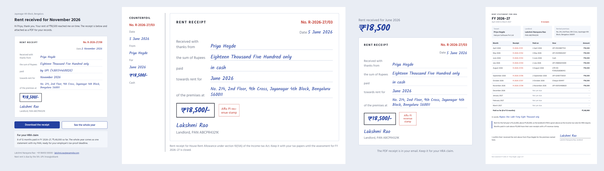
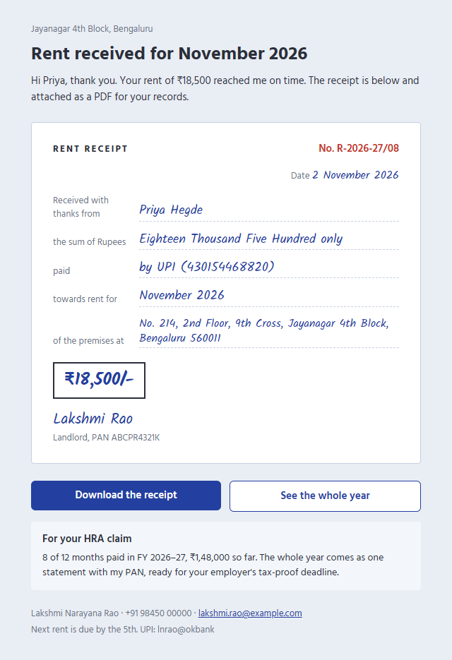
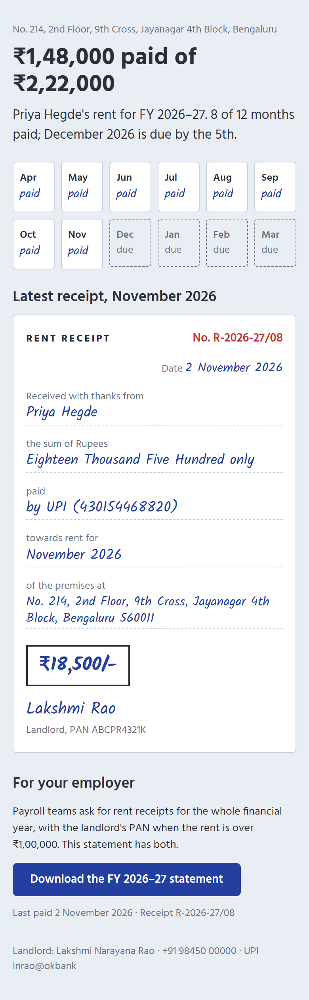
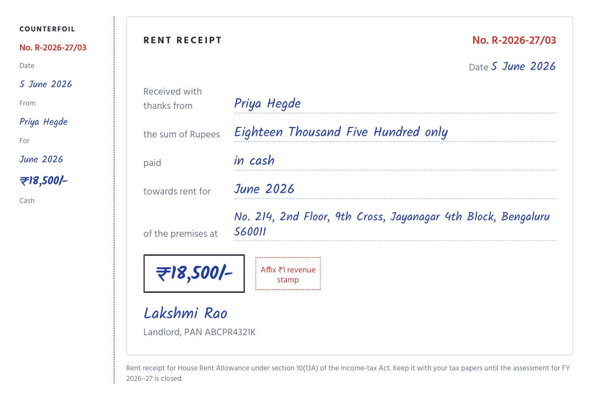
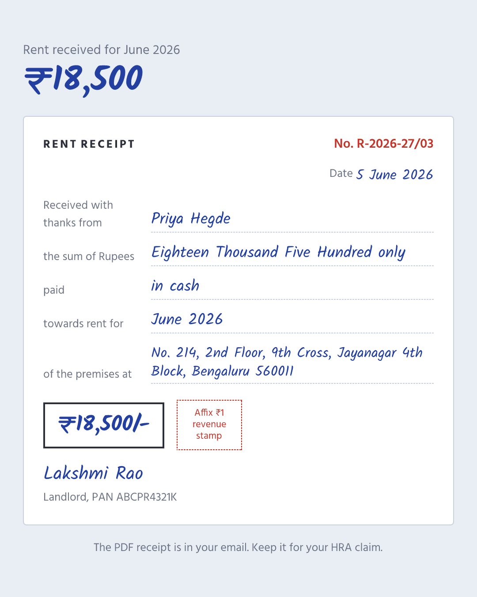

# Rent Receipt Kit

**One tenancy file in, a whole year of Indian rent receipts out.** Each month gets a receipt email, a printable PDF receipt and a WhatsApp image, and the year gets an HRA statement for the tenant's employer plus a web page. All of it is built with [Hyper Elements](https://github.com/hyper-elements/hyper-elements).



## Why this exists

Millions of salaried people in India rent their homes. Every year, between December and February, payroll asks them for rent receipts to claim House Rent Allowance. That ends up as a scramble:

- Landlords hand-write a stack of receipts from a stationery-shop receipt book.
- Tenants fill in free online generators month by month.
- Someone forgets the landlord's PAN. It's required once the year's rent goes over ₹1,00,000, and HR sends the papers back.

The kit follows those rules for you. The landlord types the tenancy once and adds each payment as it arrives (`paidOn`, `mode`, UPI reference). The kit then makes:

| Output | Hyper Elements root | What it's for |
| --- | --- | --- |
| Receipt email | `Email` → `render()` | Sent the day the rent arrives, with the receipt inline |
| Receipt PDF (A5 landscape) | `Document` → `renderPdf()` | The printable receipt, with the counterfoil the landlord keeps |
| WhatsApp image (1080×1350) | `Canvas` → `renderImage()` | Most landlords and tenants actually talk on WhatsApp |
| HRA statement PDF (A4) | `Document` → `renderPdf()` | One document for payroll: every month, total, PAN, declaration |
| Tenant page | `Page` → `render()` | The year at a glance, every receipt one tap away |

The design copies a receipt book from the stationery shop. Labels are printed in grey-black and the landlord's entries are in blue ballpoint (Kalam). The serial number is red, and the amount sits in a box written `₹18,500/-`, the way Indian receipts write it.

## The rules it gets right

The rules live in `src/rules.ts` and are covered by `tests/rules.test.ts`:

- **Landlord PAN:** shown when the year's rent is more than ₹1,00,000, the income-tax condition for HRA claims. Below that, the statement says it isn't required.
- **Revenue stamp:** a "Affix ₹1 revenue stamp" box appears only on a cash receipt above ₹5,000. In the sample, June was paid in cash. UPI, bank-transfer and cheque receipts don't get the box.
- **Amount in words, the Indian way:** lakh and crore. ₹1,48,000 is "One Lakh Forty Eight Thousand", not "One Hundred Forty Eight Thousand".
- **Indian grouping:** ₹2,22,000, not ₹222,000.
- **Financial year:** April to March. Receipt numbers run per year (`R-2026-27/03`), and months still to come show as "Not yet due" on the statement.
- **No receipt for unpaid rent:** asking for a month that has no `paidOn` throws an error instead of drawing a receipt.

## How Hyper Elements is used

- **One component, four destinations.** `ReceiptSlip` (`src/slip.tsx`) is a single tree of `Column`, `Row`, `Text` and `Span` elements. The same element is drawn into the email, the web page, the PDF and the PNG, so the four can never disagree about an amount, a date or a PAN.
- **One theme.** `defineTheme` in `src/theme.ts` holds the colours, the two font families, the type scale, the button style and the named `paper`, `hand` and `label` styles. Every root takes `theme={receiptBook}`. Colours are read with `token("colors.ink")`.
- **Each destination doing what it's good at:**
  - The Document uses a `PageFooter` with `PageNumber` and a `Table` with header and footer rows. The A5 receipt is landscape with a dashed counterfoil border.
  - The Canvas is drawn at 540×675 and written at `scale: 2`.
  - The Page uses a `Grid` of the twelve months.
  - The Email uses `previewText` and two buttons.
- **Validation in the loop.** The build runs `validate()` on every email and the page and prints any diagnostics. It fails on errors. Two things the checks caught during the build:
  - `justifyContent: "space-between"` isn't possible in email.
  - Phone styles aren't allowed in a Document or a Canvas. That's why `ReceiptSlip` takes a `web` prop and adds phone styles only for the Email and the Page.
- **Phones.** On the page and in the email, the receipt's label/value rows stack on a phone (`stackOnMobile`) and the paper's padding tightens.

| Email (desktop) | Page (phone) |
| --- | --- |
|  |  |

| Receipt PDF, cash month with the revenue stamp box | WhatsApp image |
| --- | --- |
|  |  |

## Run it

Node 20 or later:

```bash
npm install
npm run build      # validates, then writes everything to out/
npm test           # the rent rules
```

`npm run build` writes:

```
out/emails/receipt-2026-04.html (+ .txt)  … one per paid month
out/receipts/receipt-2026-04.pdf          … one per paid month
out/whatsapp/receipt-2026-04.png          … one per paid month
out/statement.pdf                         the year, for payroll
out/index.html                            the tenant's page
```

To use it for a real tenancy, edit `src/tenancy.ts` (names, PAN, address, rent, and a line per month) and build again. When the next month's rent arrives, add `paidOn` and `mode` to that month. Send the email through any provider, since `render()` returns the HTML and the plain text. Share the PNG on WhatsApp.

## Files

```
src/tenancy.ts                 the one file you edit
src/rules.ts                   PAN, revenue stamp, Indian numbers, financial year
src/theme.ts                   the receipt-book theme and web fonts
src/slip.tsx                   ReceiptSlip, shared by every output
src/templates/ReceiptEmail.tsx Email
src/templates/ReceiptPdf.tsx   Document (A5 landscape, counterfoil)
src/templates/AnnualStatement.tsx Document (A4)
src/templates/WhatsAppCard.tsx Canvas
src/templates/TenantPage.tsx   Page
scripts/build.tsx              validate + render all of it
tests/rules.test.ts            the rules
```

Fonts: [Hind](https://fonts.google.com/specimen/Hind) and [Kalam](https://fonts.google.com/specimen/Kalam) by the Indian Type Foundry (SIL Open Font License). Both have the ₹ sign and Devanagari, so Hindi labels are a theme change away.

All names, addresses, PAN and payment references in the sample are invented. This kit makes receipts; it isn't tax advice. Check your employer's own HRA rules.

MIT licence.
